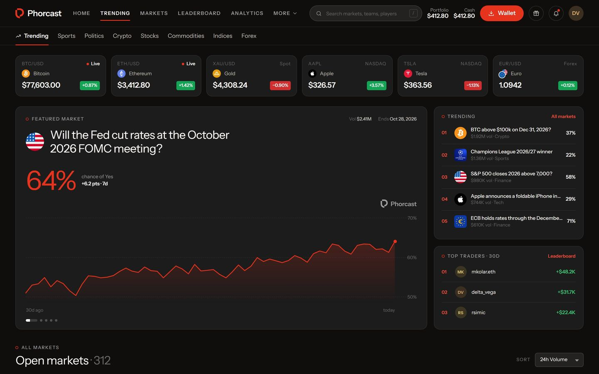

# Phorcast: product design, from audit to a live front end

Phorcast is a prediction market: people buy Yes or No on what happens next in crypto, stocks, forex, indices and sports. I joined when it looked like a starter template and the path to a first trade lost the user's pick on the way. In six weeks I took it to one type family, one brand red and a trade path that never leaves the market, then built the front end myself with Claude Code.

This repository is the process behind that work: the brief, the audit, the explorations, the flows, the design system, how the front end was built, the client feedback rounds and what I would test at launch. It contains no client backend or contract code.

| | |
|---|---|
| Role | Product designer and front-end builder, working alone on design and front end |
| Scope | Web app, marketing site, coming soon page, brand system |
| Timeline | Six weeks, Sep 16 to Oct 28, 2026, then feedback rounds on the live builds |
| Tools | Figma, Claude Code, React 19, Vite, TypeScript, Vercel |

## Live builds

| Build | Link |
|---|---|
| Web app (sample data, no backend) | https://phorcast-app-rho.vercel.app |
| Marketing site | https://phorcast-website-max-version.vercel.app |
| Coming soon page | https://phorcast-comingsoon-v2-psi.vercel.app |
| Case study page | https://phorcast-case-study.vercel.app |
| Behance | https://www.behance.net/gallery/258904083/Phorcast-Prediction-Market-Product-Design |

## What changed, in numbers

| Before | After |
|---|---|
| 6 steps from a market to a first trade | 3 steps, and the market never closes |
| 4 type families | 1 (Instrument Sans) |
| 3 different reds | 1 brand red, `#E5331E` |
| A green Trade button that did nothing at $0 | 5 ticket states, one primary action each |
| Template screens | 15 app routes, responsive down to 390px, dark and light |

The platform has no live traffic yet, so there are no conversion results here. Section 08 lists the tests I would run once there is.

## The process

| # | Step | What is in it |
|---|---|---|
| 01 | [Brief](process/01-brief.md) | Problem, user, success and what is out of scope, written before any screen |
| 02 | [Audit](process/02-audit.md) | Six problems found on the live coming soon page and in the app |
| 03 | [Brand and exploration](process/03-brand-and-exploration.md) | One family and one red, six typefaces tested, 22 hero compositions |
| 04 | [Flows, stories and wireframes](process/04-flows.md) | Six steps to three, four user stories, every branch of the ticket, low fidelity wireframes |
| 05 | [Design system](process/05-design-system.md) | Color roles, type scale, the buy and sell rule, the token file the app runs on |
| 06 | [Design to code](process/06-design-to-code.md) | How the front end was built from Figma with Claude Code, and the rules it followed |
| 07 | [Client feedback](process/07-feedback.md) | Nine before and after reports, 75 changes, shipped on live builds |
| 08 | [Launch tests](process/08-launch-tests.md) | Four A/B tests with a primary metric and a guardrail each |
| 09 | [Feature proposal: Watchlist](process/09-watchlist-proposal.md) | A feature I proposed from one client note, prototyped and checked before review |

## How I work

1. Write the brief first and judge every screen against it.
2. Audit what exists before drawing anything new.
3. Go wide, then narrow: many directions, one shipped, and the reasons written down.
4. Design the states, not just the happy path. No screen is a dead end.
5. Put the design system in code as tokens, so the product cannot drift.
6. Build the front end myself with Claude Code, and review it at 1440, 1024, 768 and 390.
7. Ship feedback in small rounds, each one checked on a live build.

---

Phorcast, its name and marks belong to Phorcast. Club, coin and company marks belong to their owners. Screens show sample market data.

Srdjan Nikšić · [Portfolio](https://srdjan-portfolio-five.vercel.app) · [Behance](https://www.behance.net/srdjanniksic) · [LinkedIn](https://www.linkedin.com/in/srdjan-niksic)
