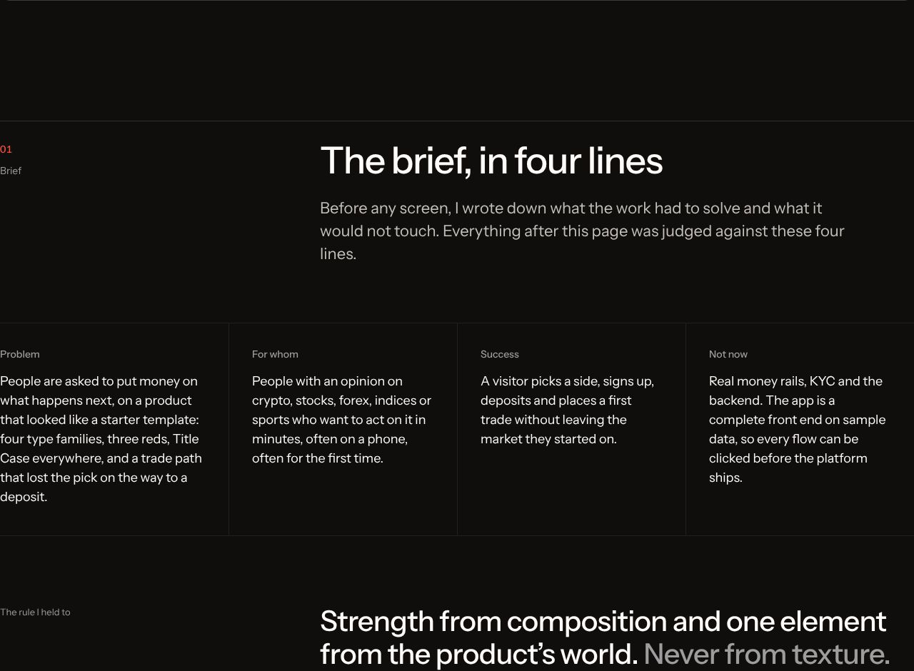

# 01 Brief

Before any screen, I wrote down what the work had to solve and what it would not touch. Everything after this page was judged against these four lines.

| | |
|---|---|
| **Problem** | People are asked to put money on what happens next, on a product that looked like a starter template: four type families, three reds, Title Case everywhere, and a trade path that lost the pick on the way to a deposit. |
| **For whom** | People with an opinion on crypto, stocks, forex, indices or sports who want to act on it in minutes, often on a phone, often for the first time. |
| **Success** | A visitor picks a side, signs up, deposits and places a first trade without leaving the market they started on. |
| **Not now** | Real money rails, KYC and the backend. The app is a complete front end on sample data, so every flow can be clicked before the platform ships. |

**The rule I held to:** strength from composition and one element from the product's world. Never from texture.

Next: [02 Audit](02-audit.md)
