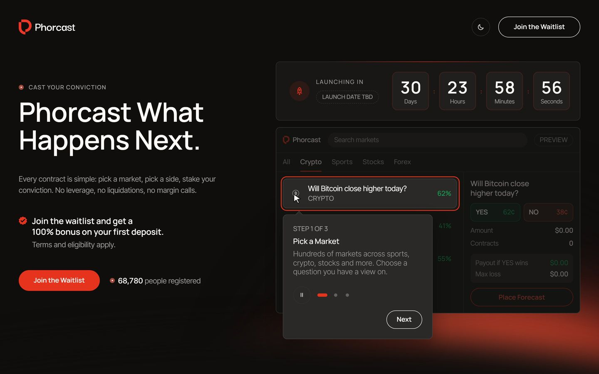
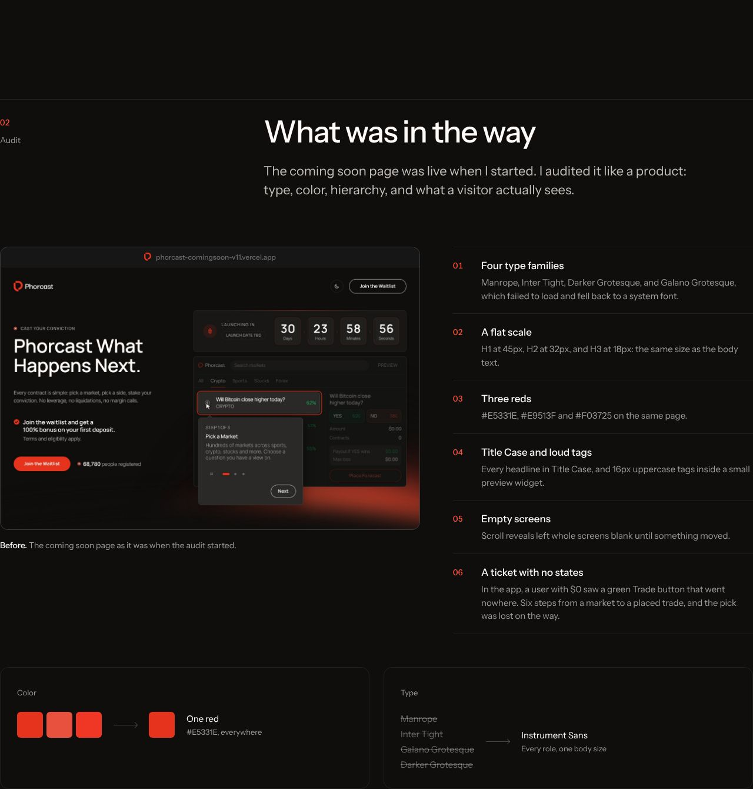

# 02 Audit

The coming soon page was live when I started. I audited it like a product: type, color, hierarchy, and what a visitor actually sees.

| # | Problem | What I found |
|---|---|---|
| 1 | Four type families | Manrope, Inter Tight, Darker Grotesque, and Galano Grotesque, which failed to load and fell back to a system font. |
| 2 | A flat scale | H1 at 45px, H2 at 32px, and H3 at 18px: the same size as the body text. |
| 3 | Three reds | `#E5331E`, `#E9513F` and `#F03725` on the same page. |
| 4 | Title Case and loud tags | Every headline in Title Case, and 16px uppercase tags inside a small preview widget. |
| 5 | Empty screens | Scroll reveals left whole screens blank until something moved. |
| 6 | A ticket with no states | In the app, a user with $0 saw a green Trade button that went nowhere. Six steps from a market to a placed trade, and the pick was lost on the way. |

Problems 1 to 4 became the brand system ([03](03-brand-and-exploration.md) and [05](05-design-system.md)). Problem 6 became the flow work ([04](04-flows.md)).

Next: [03 Brand and exploration](03-brand-and-exploration.md)
