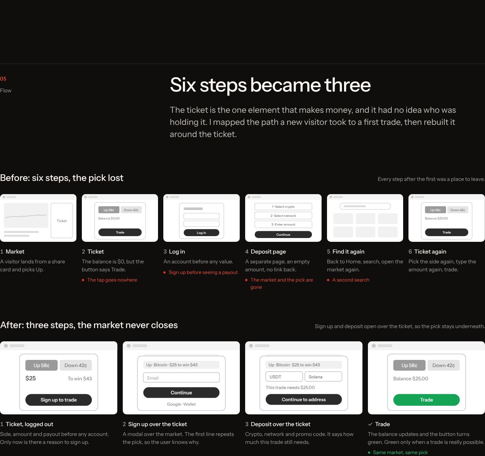
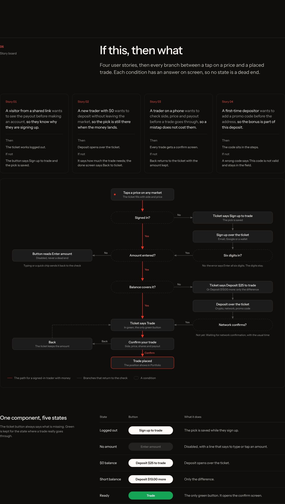
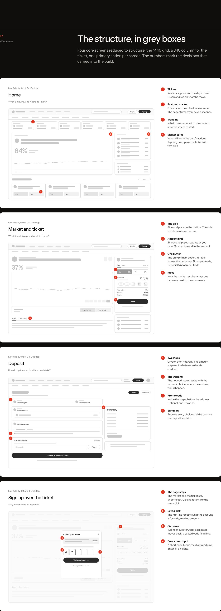

# 04 Flows, stories and wireframes

## Six steps became three

The ticket is the one element that makes money, and it had no idea who was holding it. I mapped the path a new visitor took to a first trade, then rebuilt it around the ticket.

**Before: six steps, the pick lost.** Every step after the first was a place to leave.

| # | Step | What went wrong |
|---|---|---|
| 1 | Market | A visitor lands from a share card and picks Up. |
| 2 | Ticket | The balance is $0, but the button says Trade. The tap goes nowhere. |
| 3 | Log in | An account before any value. Sign up before seeing a payout. |
| 4 | Deposit page | A separate page, an empty amount, no link back. The market and the pick are gone. |
| 5 | Find it again | Back to Home, search, open the market again. |
| 6 | Ticket again | Pick the side again, type the amount again, trade. |

**After: three steps, the market never closes.** Sign up and deposit open over the ticket, so the pick stays underneath.

| # | Step | What it does |
|---|---|---|
| 1 | Ticket, logged out | Side, amount and payout before any account. Only now is there a reason to sign up. |
| 2 | Sign up over the ticket | A modal over the market. The first line repeats the pick, so the user knows why. |
| 3 | Deposit over the ticket | Crypto, network and promo code. It says how much this trade still needs. |
| ✓ | Trade | The balance updates and the button turns green. Green only when a trade is really possible. |

## User stories and every branch

Four user stories, then every branch between a tap on a price and a placed trade. Each condition has an answer on screen, so no state is a dead end.

| # | Story | Then | If not |
|---|---|---|---|
| 01 | A visitor from a shared link wants to see the payout before making an account, so they know why they are signing up. | The ticket works logged out. | The button says Sign up to trade and the pick is saved. |
| 02 | A new trader with $0 wants to deposit without leaving the market, so the pick is still there when the money lands. | Deposit opens over the ticket. | It says how much the trade needs; the done screen says Back to ticket. |
| 03 | A trader on a phone wants to check side, price and payout before a trade goes through, so a mistap does not cost them. | Every trade gets a confirm screen. | Back returns to the ticket with the amount kept. |
| 04 | A first-time depositor wants to add a promo code before the address, so the bonus is part of this deposit. | The code sits in the steps. | A wrong code says This code is not valid and stays in the field. |

## One component, five states

The ticket button always says what is missing. Green is kept for the state where a trade really goes through.

| State | Button | What it does |
|---|---|---|
| Logged out | Sign up to trade | The pick is saved while they sign up. |
| No amount | Enter amount | Disabled, with a line that says to type or tap an amount. |
| $0 balance | Deposit $25 to trade | Deposit opens over the ticket. |
| Short balance | Deposit $13.00 more | Only the difference. |
| Ready | Trade | The only green button. It opens the confirm screen. |

## Wireframes

Four core screens reduced to structure: the 1440 grid, a 340 column for the ticket, one primary action per screen. The numbers mark the decisions that carried into the build.

| Screen | Question it answers |
|---|---|
| Home | What is moving, and where do I start? |
| Market and ticket | What does this pay, and what do I press? |
| Deposit | How do I get money in without a mistake? |
| Sign up over the ticket | Why am I making an account? |

Next: [05 Design system](05-design-system.md)
