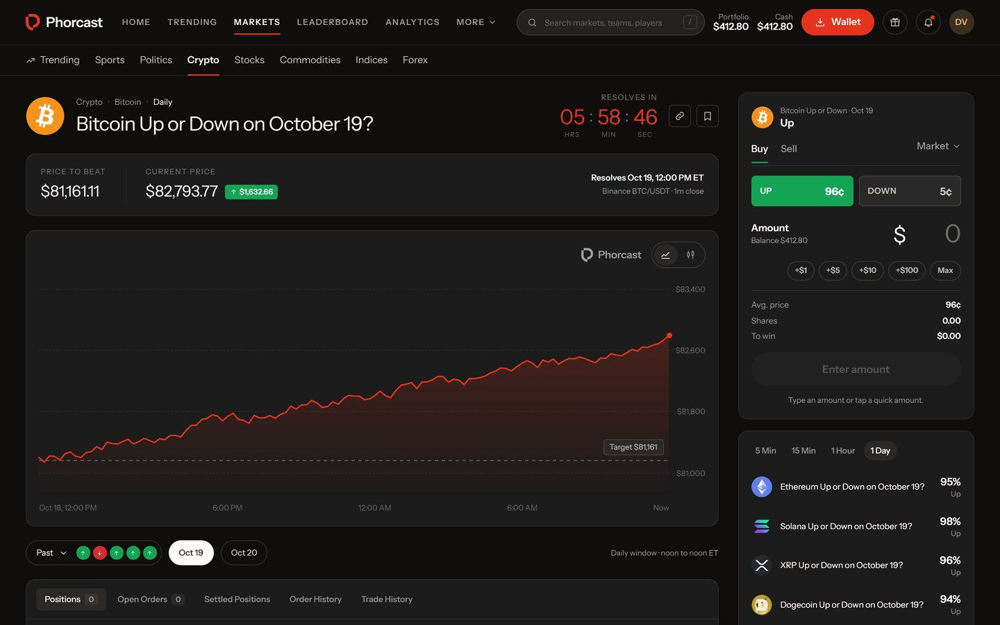
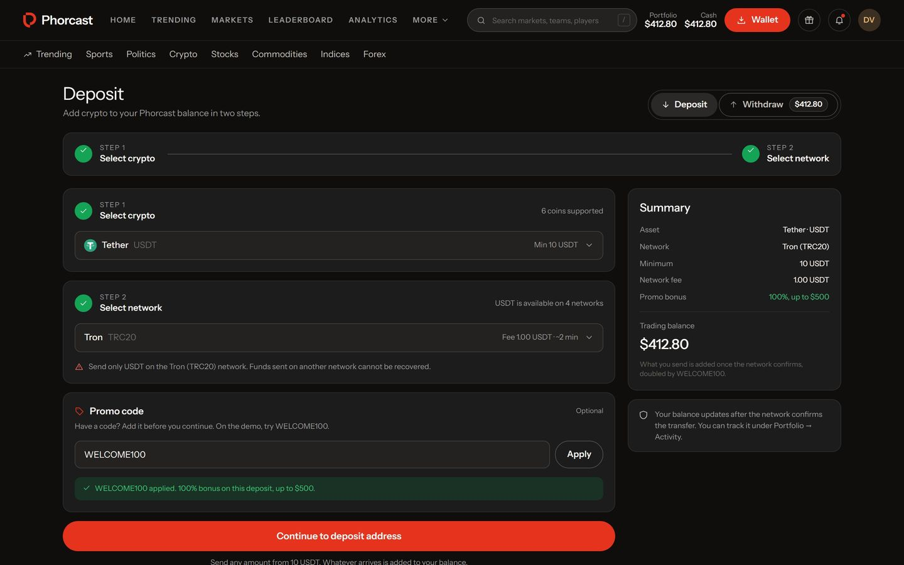
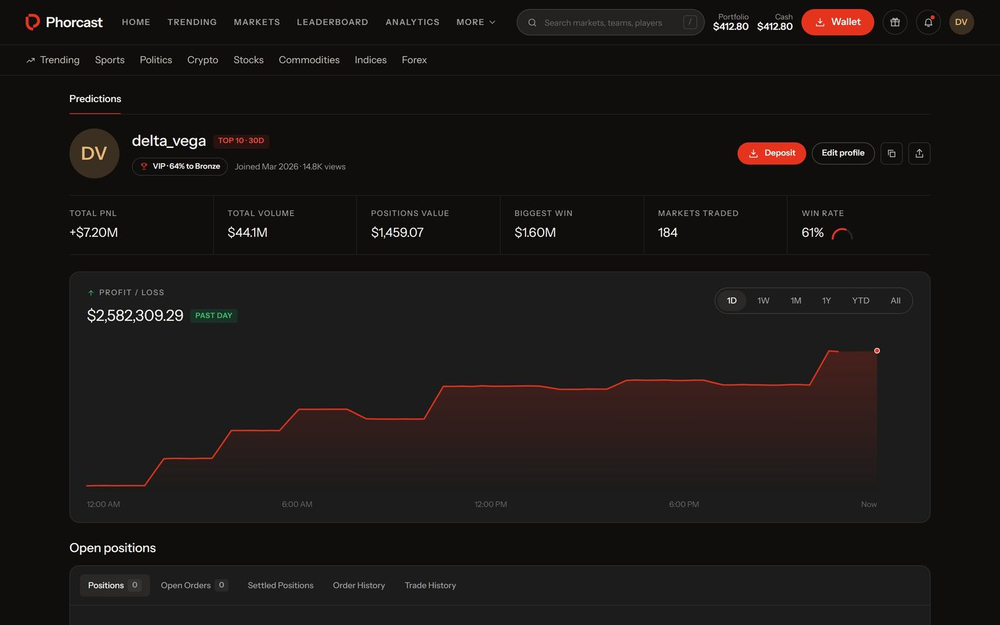
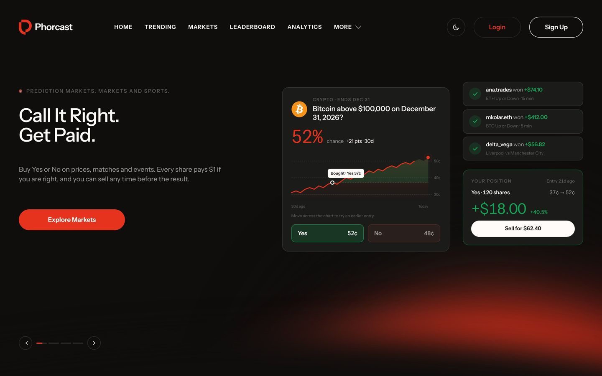

# 06 Design to code

I designed the app in Figma, then built the front end myself with Claude Code. The result is a complete front end on sample data: 15 routes, every state of the trade path, dark and light, responsive down to 390px. It was live on Oct 23, eight days after the client picked the direction.

**Stack:** React 19, Vite, TypeScript, react-router-dom, deployed on Vercel. About 8,000 lines of TypeScript in 36 React components and pages.

**Live:** https://phorcast-app-rho.vercel.app

## How the work was set up

The key was a short build spec that Claude Code read before every task. It made Figma the source of truth and turned the design system into rules the code could not break. These are the rules, as I wrote them:

> - One family (Instrument Sans), brand red `--accent`. Green and red ONLY for buy-sell and gain-loss. Everything else uses roles (`--ink`, `--ink-2`, `--muted`, `--dim`, `--card`, `--line`).
> - Never hex colours in page CSS. Light mode must work: pure white and neutral greys, no glows, no shadows, no gradients on surfaces.
> - Sentence case for anything new. No invented claims about the product.
> - One primary action per screen.
> - Responsive: check 1440, 1024, 768, 390. Phones get a bottom tab bar (64px) and the ticket as a bottom bar and sheet. No horizontal page scroll at 390.
> - Page CSS lives in its own file with a page prefix. Shared files are not edited from a page task. If something shared is missing, say so in the report.

## The loop

1. **Figma first.** Every screen is drawn in Figma. The spec names the Figma file and page, and the copy is the Figma copy.
2. **Build one page per task**, using the shared kit: layout helpers, buttons, chips, tabs, charts, the ticket and the market card.
3. **Check it in a browser**: screenshots at four widths, in both themes, plus a TypeScript and lint check.
4. **Compare with Figma** and fix the differences before the next page.
5. **Ship to Vercel** so every review happens on a live build, not on a static image.

## Structure

```
src/
├── styles/      tokens.css (the design system) and base.css (layout and components)
├── ui/          Icon, Glyphs (coins, crests, flags), Chart (line, candle, bar, gauge), Kit (modal, countdown, toggle)
├── trade/       Ticket, MarketCard, Positions, Comments, Share, Watchlist
├── layout/      Header, footer, chat
├── pages/       Home, Markets, Market, Event, Sports, Crypto, UpDown, Range,
│                Leaderboard, Profile, Wallet, Deposit, Transactions, Settings, Referrals, Token
└── data/        Sample markets, sports, crypto, people and token data
```

## Screens

| | |
|---|---|
|  **Market and ticket.** Price buttons show the side. The ticket does the maths as you type and names the next step. |  **Sports.** Live games with moneyline, spread and total in one row, each team with its crest. |
|  **Up or Down.** Short crypto markets with a countdown, the live price line and your positions under the chart. |  **Confirm your trade.** A review of side, price, shares and payout before every trade. |
|  **Sign up over the ticket.** The saved pick says what the account is for. Six boxes, paste fills them all. |  **Deposit.** Two steps, the promo code before the address, a summary that repeats every choice. |
|  **Leaderboard.** Period filters. Your own rank stays pinned above the table. |  **Profile.** Profit and loss over time, the stats that matter, and open positions. |
|  **Light theme.** Pure white and neutral greys, with no glows. |  **Marketing site.** The client's React code and motion stayed one to one. I restyled it to the new system. |

## Code excerpts

The full app source stays private. These excerpts show how design decisions became code. The files are in [`code/`](code/).

### The ticket: five states, one button

The design rule from [04](04-flows.md) was that the ticket's one primary button always names the next step, and green is kept for a trade that really goes through. In code that is a single decision chain. The states table sits at the top of the file, so anyone reading the code reads the design first.

```tsx
let cta: { label: string; kind: string; onClick?: () => void; disabled?: boolean; note: string };
if (!user) cta = { label: 'Sign up to trade', kind: 'inverse', onClick: () => open({ type: 'auth', mode: 'signup' }), note: 'Your position is saved while you sign up.' };
else if (need <= 0) cta = kind === 'market'
  ? { label: 'Enter amount', kind: 'muted', disabled: true, note: 'Type an amount or tap a quick amount.' }
  : { label: 'Enter shares', kind: 'muted', disabled: true, note: 'Set your price and how many shares to buy.' };
else if (cash <= 0) cta = { label: `Deposit ${usd(need, need % 1 ? 2 : 0)} to trade`, kind: 'inverse', onClick: () => open({ type: 'deposit', need }), note: 'Deposit opens here. Your position stays saved.' };
else if (cash < need) cta = { label: `Deposit ${usd(need - cash)} more`, kind: 'inverse', onClick: () => open({ type: 'deposit', need: Math.ceil((need - cash) * 100) / 100 }), note: 'Only the difference. Your position stays saved.' };
else cta = kind === 'market'
  ? { label: 'Trade', kind: 'buy', onClick: () => submit({ kind: 'market', amount }), note: '' }
  : { label: 'Place order', kind: 'buy', onClick: () => submit({ kind: 'limit', limit, shares: lShares, expires: expiring ? expiry : 'Until cancelled' }), note: '' };
```

Things to notice:

- `kind: 'buy'` (green) appears only in the last branch. Every other state uses the neutral inverse button, so the color rule from the design system holds by construction.
- Deposit opens over the ticket (`open({ type: 'deposit', need })`) and passes how much this trade still needs, so the pick is never lost. That is the six steps to three from [04](04-flows.md).
- Every state has a note under the button. No state is a dead end.

Full excerpt: [`code/Ticket.excerpt.tsx`](code/Ticket.excerpt.tsx)

### The watchlist bookmark

One component wherever a market shows, so the icon behaves the same on every page. It says what happened and always offers the next step: View watchlist after saving, Undo after removing, back in the same place.

```tsx
const flip = () => {
  if (on) {
    const at = watching.indexOf(id);
    setWatch(id, false);
    toast({ tone: 'info', title: 'Removed from your watchlist', body: title, actions: [{ label: 'Undo', run: () => setWatch(id, true, at) }] });
  } else {
    setWatch(id, true);
    toast({ tone: 'success', title: 'Added to your watchlist', body: title, actions: [{ label: 'View watchlist', to: '/watchlist' }] });
  }
};
```

Full file: [`code/Watch.tsx`](code/Watch.tsx). The proposal behind it: [09](09-watchlist-proposal.md).

### One shape for every pick

Every page turns a price button into a ticket pick through the same functions, so the ticket always gets the same shape, whether the market is a binary question, a game or a crypto range. [`code/picks.excerpt.ts`](code/picks.excerpt.ts)

### Responsive by tokens

Below 1024px the ticket becomes a bar at the bottom of the screen that opens as a sheet. Every value in the CSS is a token role, so the bar works in both themes without extra rules. [`code/Ticket.excerpt.css`](code/Ticket.excerpt.css)

Next: [07 Client feedback](07-feedback.md)
