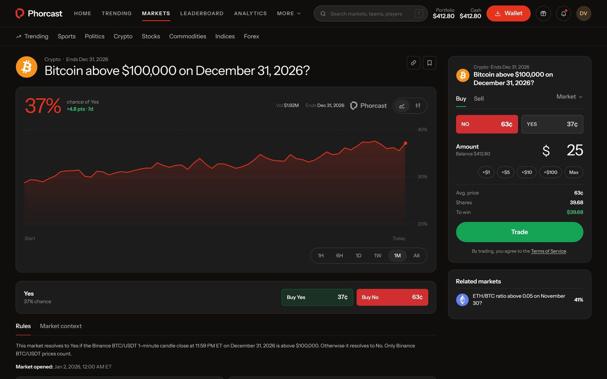
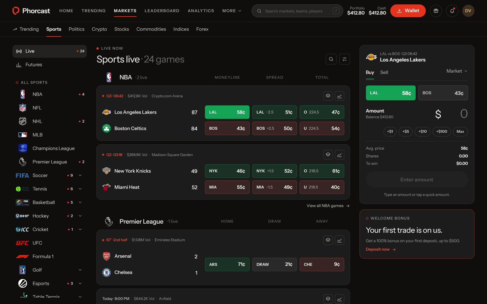
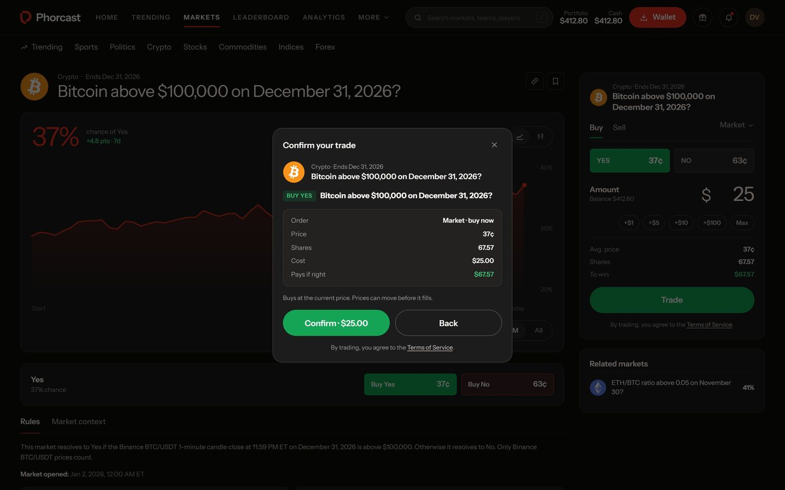
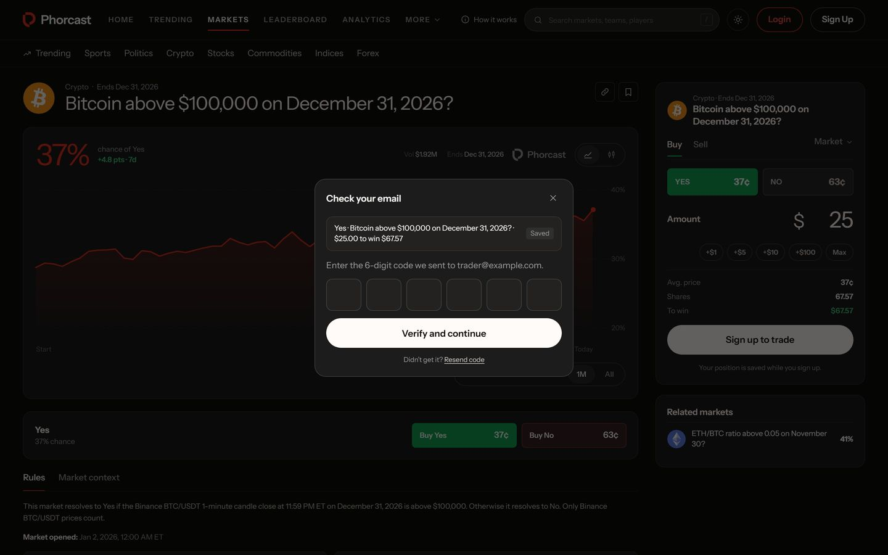
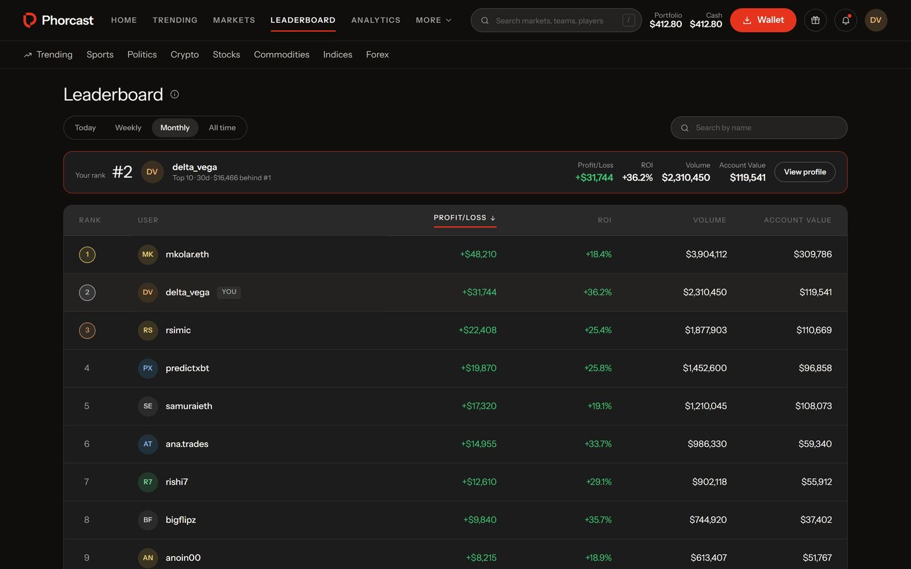
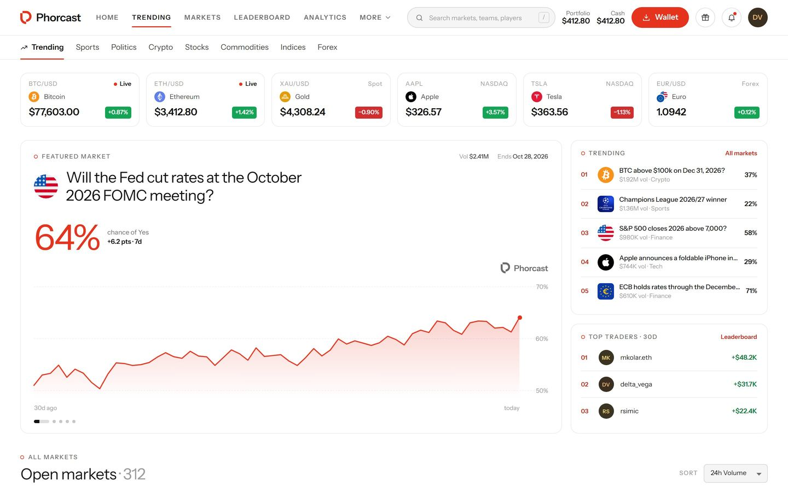

# 06 Design to code

I designed the app in Figma, then built the front end myself with Claude Code. The result is a complete front end on sample data: 15 routes, every state of the trade path, dark and light, responsive down to 390px. It was live on Oct 23, eight days after the client picked the direction.

**Stack:** React 19, Vite, TypeScript, react-router-dom, deployed on Vercel. About 8,000 lines of TypeScript in 36 React components and pages.

**Live:** https://phorcast-app-rho.vercel.app

## How the work was set up

The key was a short build spec that Claude Code read before every task. It made Figma the source of truth and turned the design system into rules the code could not break. These are the rules, as I wrote them:

> - One family (Instrument Sans), brand red `--accent`. Green and red ONLY for buy-sell and gain-loss. Everything else uses roles (`--ink`, `--ink-2`, `--muted`, `--dim`, `--card`, `--line`).
> - Never hex colours in page CSS. Light mode must work: pure white and neutral greys, no glows, no shadows, no gradients on surfaces.
> - Sentence case for anything new. No invented claims about the product.
> - One primary action per screen.
> - Responsive: check 1440, 1024, 768, 390. Phones get a bottom tab bar (64px) and the ticket as a bottom bar and sheet. No horizontal page scroll at 390.
> - Page CSS lives in its own file with a page prefix. Shared files are not edited from a page task. If something shared is missing, say so in the report.

## The loop

1. **Figma first.** Every screen is drawn in Figma. The spec names the Figma file and page, and the copy is the Figma copy.
2. **Build one page per task**, using the shared kit: layout helpers, buttons, chips, tabs, charts, the ticket and the market card.
3. **Check it in a browser**: screenshots at four widths, in both themes, plus a TypeScript and lint check.
4. **Compare with Figma** and fix the differences before the next page.
5. **Ship to Vercel** so every review happens on a live build, not on a static image.

## Structure

```
src/
├── styles/      tokens.css (the design system) and base.css (layout and components)
├── ui/          Icon, Glyphs (coins, crests, flags), Chart (line, candle, bar, gauge), Kit (modal, countdown, toggle)
├── trade/       Ticket, MarketCard, Positions, Comments, Share, Watchlist
├── layout/      Header, footer, chat
├── pages/       Home, Markets, Market, Event, Sports, Crypto, UpDown, Range,
│                Leaderboard, Profile, Wallet, Deposit, Transactions, Settings, Referrals, Token
└── data/        Sample markets, sports, crypto, people and token data
```

## Screens

| | |
|---|---|
|  **Market and ticket.** Price buttons show the side. The ticket does the maths as you type and names the next step. |  **Sports.** Live games with moneyline, spread and total in one row, each team with its crest. |
|  **Up or Down.** Short crypto markets with a countdown, the live price line and your positions under the chart. |  **Confirm your trade.** A review of side, price, shares and payout before every trade. |
|  **Sign up over the ticket.** The saved pick says what the account is for. Six boxes, paste fills them all. |  **Deposit.** Two steps, the promo code before the address, a summary that repeats every choice. |
|  **Leaderboard.** Period filters. Your own rank stays pinned above the table. |  **Profile.** Profit and loss over time, the stats that matter, and open positions. |
|  **Light theme.** Pure white and neutral greys, with no glows. |  **Marketing site.** The client's React code and motion stayed one to one. I restyled it to the new system. |

## What the code repository does not include

The app source stays in the client's private repository. This page shows how it was built and what it follows, not the code itself.

Next: [07 Client feedback](07-feedback.md)
