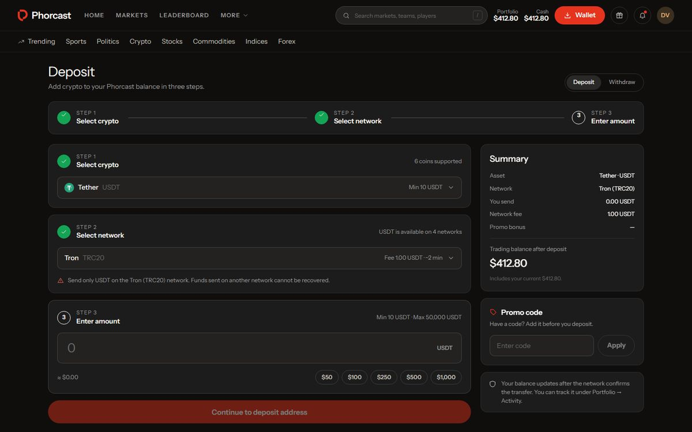
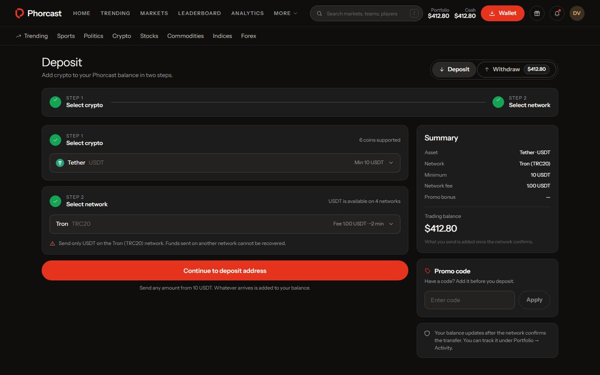
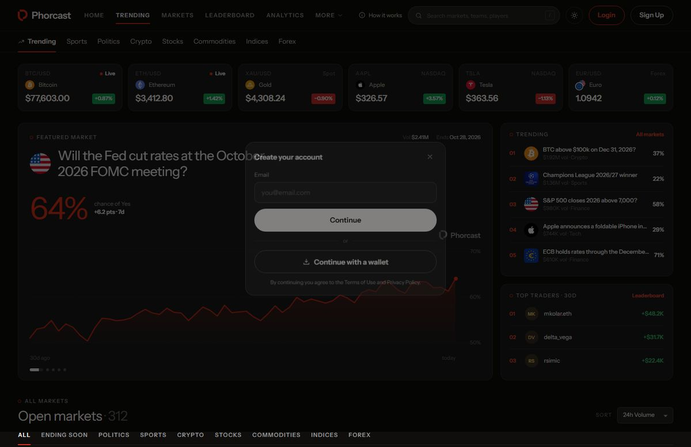
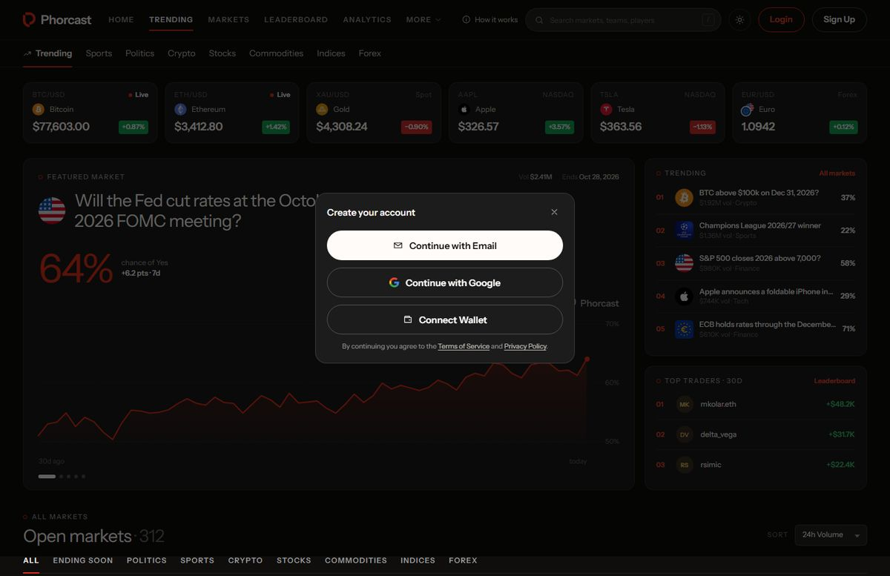
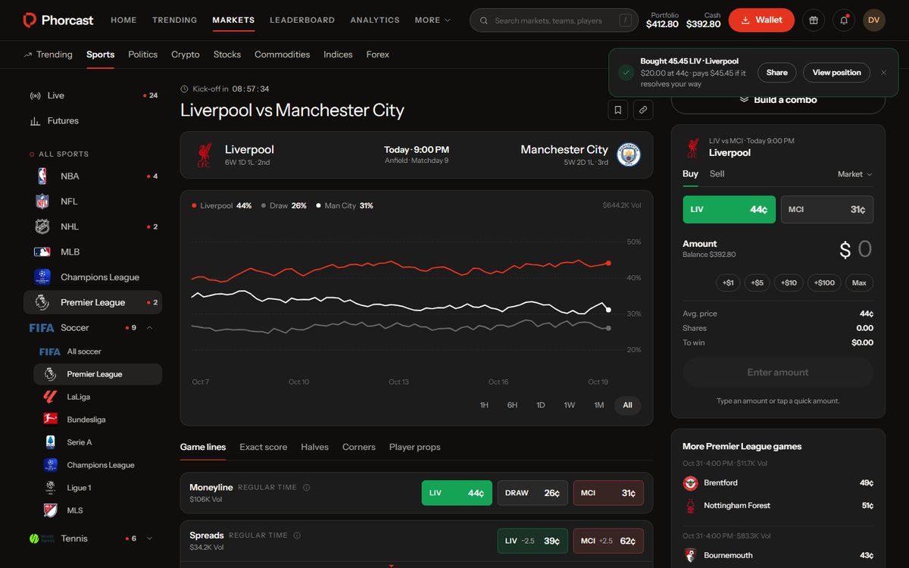
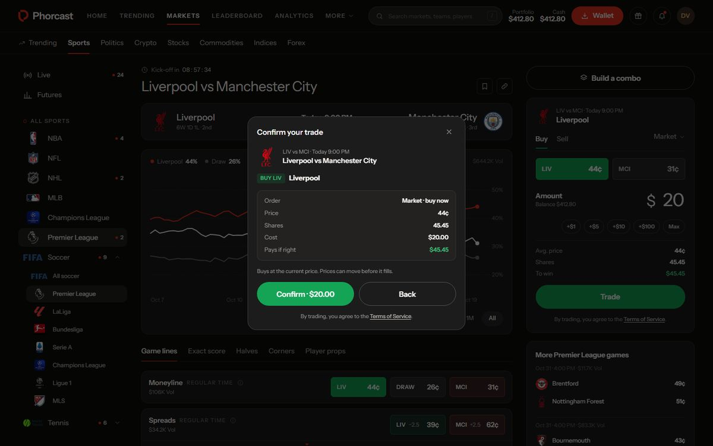
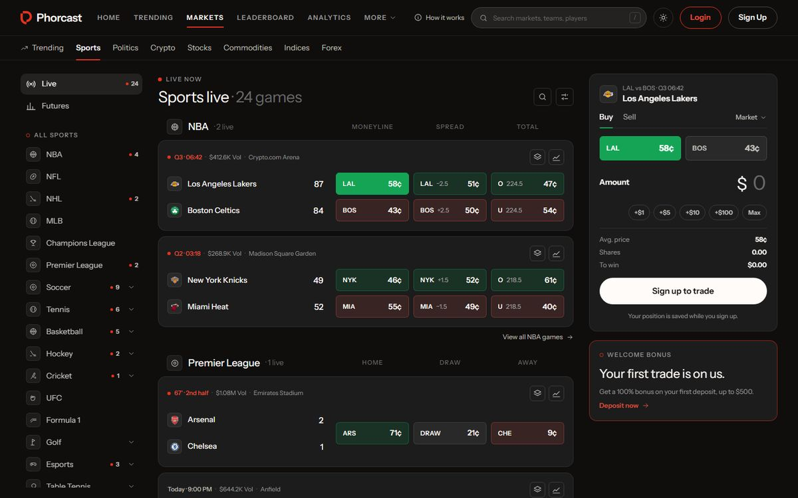
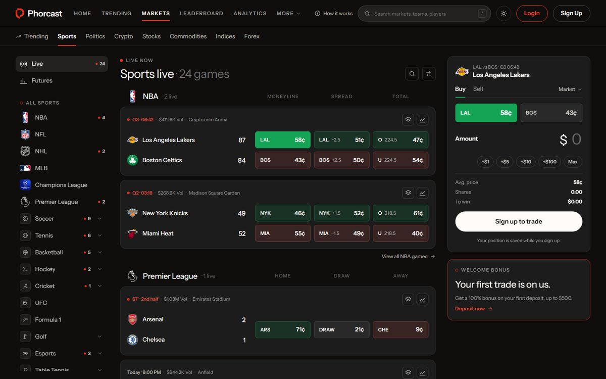

# 07 Client feedback

After the app went live on Oct 23, the client sent notes in batches. I shipped them in small rounds, one at a time, so every review happened on a live build. The first 41 notes were closed in three days. For each round I made a before and after report: the client's note, what changed, and both screens side by side.

All reports: https://phorcast-feedback.vercel.app

| Report | Changes | What it covered |
|---|---|---|
| 1 | 15 | Real logos on every market, four sort options, leaderboard columns, the same menu on app and site, deposit without the amount step, an easier Withdraw, the $CAST logo and labels, chart watermark, no fixed $25 in the ticket |
| 2 | 4 | Real icons in the app and on the site, the full icon set, rewards table spacing |
| 3 | 6 | Badges at full size, real club crests, flags for indices, tables laid out like Live trades |
| 4 | 12 | Private account, limit orders, sign-up order, a confirm step before every trade, working links, brand kit page, dark theme by default |
| 5 | 13 | Likes and replies on comments, VIP, My Account and Security, a custom default amount, Transactions, settled positions |
| 6 | 5 | A Tip button on profiles, the Wallet box, chat, a profile from the chat, phones |
| 7 | 7 | Users in search, languages on the platform and the site, images in the chat, Sell on your profile |
| 8 | 7 | Live charts: Bitcoin Up or Down, market pages, sports games, price ranges, candles, phones |
| 9 | 6 | The watchlist and share cards (see [09](09-watchlist-proposal.md)) |
| **Total** | **75** | |

## Four examples

**Three deposit steps became two.** The amount step asked for a number the network decides anyway. Whatever arrives is credited, so the step went.

| Before | After |
|---|---|
|  |  |

**Three ways in, in the client's order.** Sign-up used to open on an email form with a wallet link under it. Now it opens on Email, Google and Wallet as equals.

| Before | After |
|---|---|
|  |  |

**A confirm step before every trade.** The ticket used to place the trade on the first tap. Now Trade opens a review, then Trade placed.

| Before | After |
|---|---|
|  |  |

**Real crests at full size.** League and team icons were outline glyphs in grey tiles. Now each is the real mark at the full size of its slot, with nothing behind it.

| Before | After |
|---|---|
|  |  |

Next: [08 Launch tests](08-launch-tests.md)
