# 09 Feature proposal: Watchlist

One client note started this: saving a market showed "Saved to your list", but there was no list to open. Instead of patching the message, I proposed the feature behind it: the same save icon on every market, one list page, and an entry in the header that shows how many markets are on it.

Every "proposal" screen below was captured in a working prototype on desktop (1440px, dark theme), in a separate copy of the app. The live app stayed untouched until the client approved it. The feature then shipped in feedback report 9.

## 01 The problem

| | |
|---|---|
| **Problem** | You save a market and later cannot find it. The message promises a list that does not exist. |
| **For whom** | A trader who watches a market before entering a trade and comes back when the price moves. |
| **Success** | After saving, the list is one click away from the message, and later you find it yourself from the header. Saved markets survive a refresh and work the same on every market type. |
| **Today** | Three different behaviors: a game says "Saved to your list", a market says "Saved to your watchlist" and the icon stays empty, Bitcoin and crypto cards only fill the icon. Nothing is remembered once you leave the page. |

| Game: a message, but no list | Market: a different message, the icon stays empty | /watchlist today: the page does not exist |
|---|---|---|
| 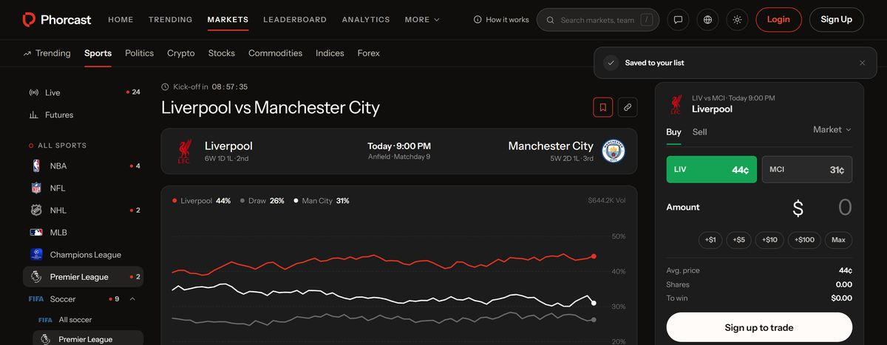 | 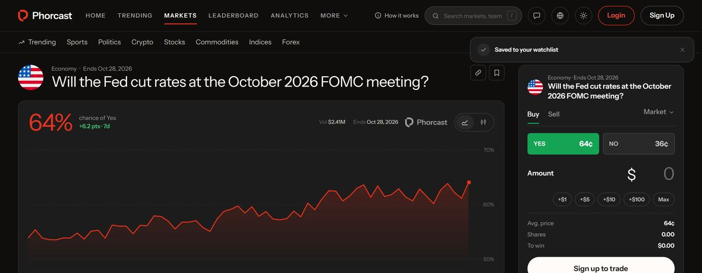 | 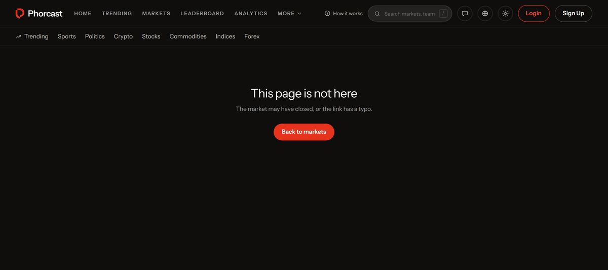 |

## 02 Saving

A click fills the icon and adds the market to the list. The message says what was saved and offers **View watchlist**. The count on the header icon goes up by one, so you see where the list lives. The count is neutral, not red: it is a number of markets, not a notification.

One name everywhere: Watchlist, on the button, the message, the menu and the page. The market page already used it, and so do Kalshi and Polymarket.

| After a click: a message with a link, 1 in the header | When the message is gone, the icon stays filled |
|---|---|
| 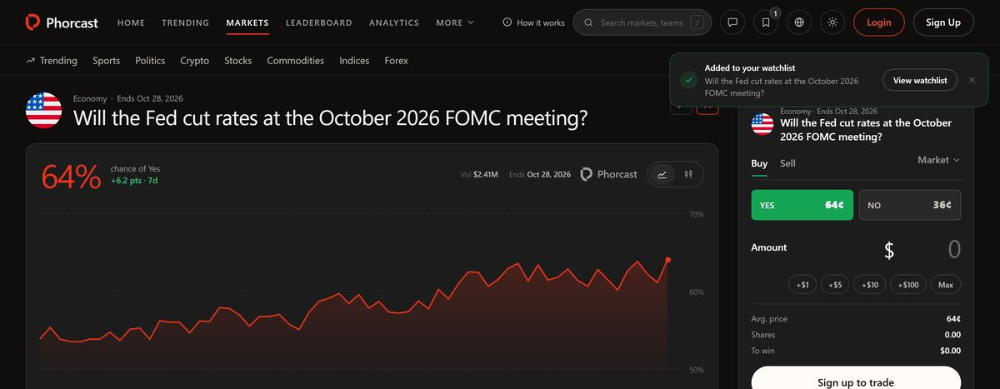 | 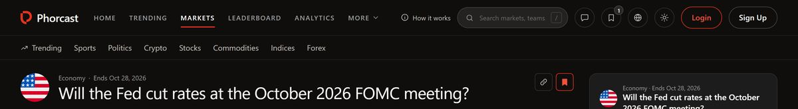 |

## 03 The same icon everywhere

The same icon and behavior on the market page, games, Bitcoin Up or Down, price ranges and crypto cards. New: market cards, game cards and the price ranges page, which had no icon before. The state is shared: a market saved on its own page is already filled on its card, and the other way round.

| Market cards: saved on the left, not saved on the right | Game card, next to the chart link |
|---|---|
| 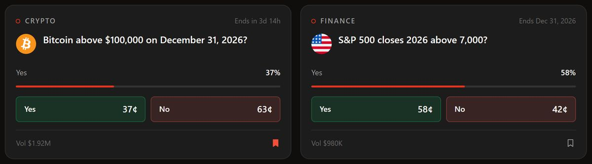 | 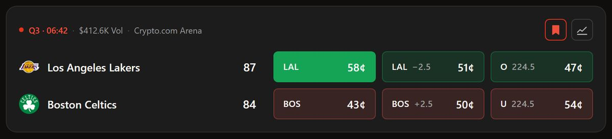 |

## 04 The list

The `/watchlist` page: one row per market, the last saved first. Each row has the market's icon, title, category and end date, and the current chance of the leading outcome. The same row works for every type: market, game and crypto. A click opens the market.

Rows, not cards: five market types carry different data, and a row gives them all one shape that stays easy to scan.

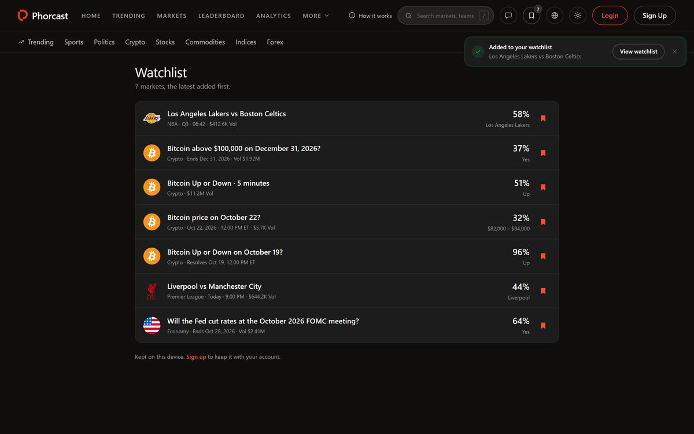

## 05 Removing

A click on a filled icon removes the market, with no "are you sure". The message offers **Undo**, which puts it back in the same place. In the list the icon is quieter than on the market page, so the rows lead.

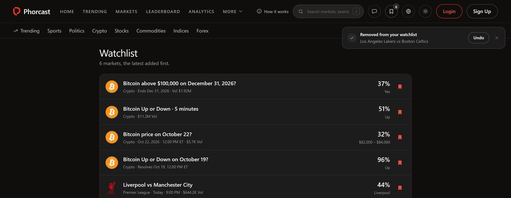

## 06 Where the list lives

| Place | Entry |
|---|---|
| Header | An icon with the count, for everyone, guests included. Always in the same place. |
| Message | **View watchlist**, right after saving. |
| Profile | Watchlist in the profile menu, for signed-in users. |
| Phone | Watchlist in the menu, for everyone. |

I did not add a "Saved" tab on the Markets page: a personal list does not belong among public categories.

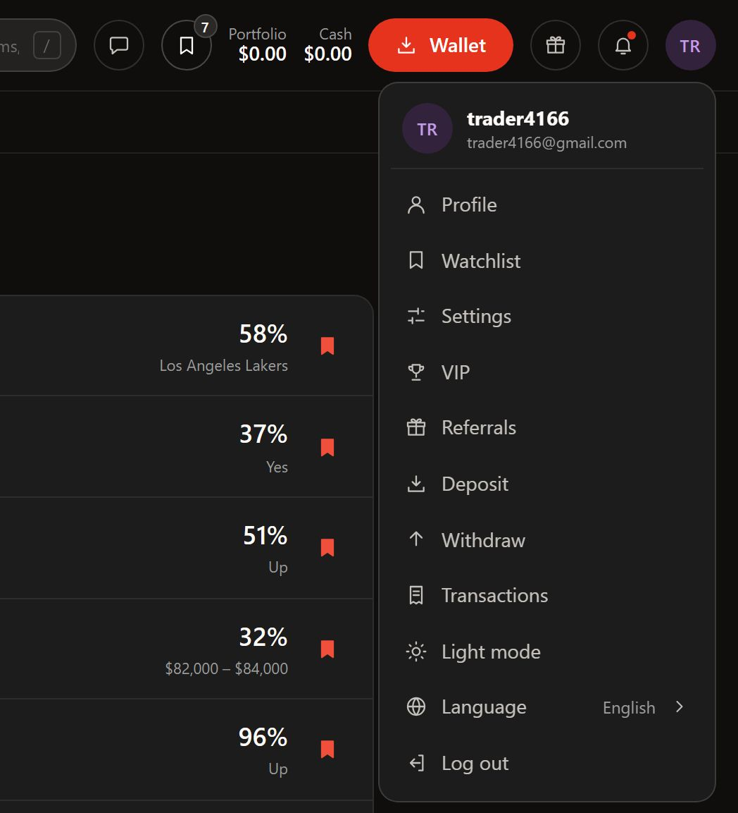

## 07 Guest and account

A guest can save without signing in: the list is kept on the device, and under it the page says *Kept on this device. Sign up to keep it with your account.* When the guest signs up, the list moves into the account. After sign-out, the account's list is not shown to the next person on the same device. Asking for sign-in before saving would be a barrier for something small.

## 08 States

| State | What the user sees |
|---|---|
| Empty | *Nothing on your watchlist yet*, one line of instruction ("Click" on desktop, "Tap" on phones) and a **Browse markets** button. No count in the header. |
| Already saved | The icon is filled everywhere the market appears. A second click removes it, with Undo. |
| Error | In a browser that does not keep data (a private window), the list works while the tab is open, and says so: *Kept until you close this tab.* |
| Loading | None yet: the list is on the device. When the API arrives, rows hold their place while loading. |
| Market removed | The row is not shown. |

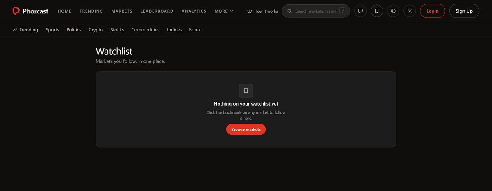

## Not now

- A notification when the price of a saved market moves: it needs a notification server.
- Closed markets with their outcome on the list: it needs market status from the API.
- Several lists, sorting and filters: the list stays simple until there is a reason for more.
- The phone layout: after approval, as an extension of this proposal. The phone menu entry is already in place.

## How it was checked

The prototype was checked in headless Chrome, 33 of 33 checks passed: saving from all seven places, memory after refresh, the counter, the list, Undo, guest sign-up, sign-out, and no console errors.

Back to the [overview](../README.md)
